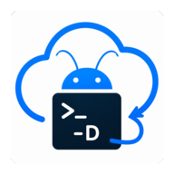

# SSHInjector

<div align="center">

**🌐 Languages:** [中文](README.md) · [English](README.en.md) · [Русский](README.ru.md)

</div>

<p align="center">
  
</p>

<div align="center">
  
  
  
  
  
</div>

<div align="center">
  <h3>🔐 Android 14+ SSH SOCKS5 proxy app</h3>
  <p>VpnService captures traffic; an in-app SOCKS5 server forwards it over SSH direct-tcpip tunnels; only whitelisted apps are routed through the proxy.</p>
</div>

---

## ✨ Features

| Feature | Description |
|---------|-------------|
| **One-click server provisioning (wizard)** | Server list → **+** → "One-click server provisioning": creates the `sshproxy` account, chroot isolation, deploys the public key and hardens sshd (OpenSSH / dropbear / OpenWrt) |
| **SSH key auth** | ECDSA P-256 (wizard default); P-384 / RSA 4096 / Ed25519 can be imported. Keys stored in Android Keystore, biometric unlock, public key export |
| **SOCKS5 proxy** | TCP CONNECT proxy with IPv4/IPv6/domain support. **No UDP relay**: non-DNS UDP (QUIC/games) is dropped and counted — see note below |
| **Whitelist mode** | `VpnService.addAllowedApplication()` — only selected apps go through the proxy |
| **Dual-stack network** | IPv4 + IPv6 with dual-stack addresses on the TUN interface |
| **Remote DNS** | Intercepts UDP:53; REMOTE/WHITELIST return fake IPs (`198.18.x.x` / `fd00::x`) and resolve domain names at the remote end over SSH; SYSTEM/domain-split use protected local sockets |
| **Domain access stats** | Per-session domain list (connections/bytes/app UID), local & remote real-IP resolve, CSV export, suggest → review → apply to ad/proxy lists (undo supported) |
| **Connection stats** | Connection status, traffic, session time (in-process real-time stats) |
| **Auto-reconnect** | Auto-reconnect on network switch (WiFi↔5G, 2s debounce); SSH session-level linear backoff |
| **Connectivity health** | 15s end-to-end probe + staged health (TUN/DNS/forward); failures attributed per step: degraded/failed · &lt;step&gt; |
| **In-app log** | Copy/export logs to `Download/`; includes data-plane snapshots and a failure-attribution summary — no adb required |
| **Material 3 UI** | Dashboard, servers, whitelist, domain stats, logs, settings, key management |

> **UDP note**: this is a TCP SOCKS5 proxy — no UDP ASSOCIATE. DNS (UDP:53) is intercepted by the app; all other UDP (QUIC/games) entering the TUN is dropped and counted (snapshot line "UDP dropped N"). QUIC does not fall back to TCP on ICMP errors, so affected apps retry on their own and may appear stuck.

---

## 🏗 Architecture

```
┌─────────────────────────────────────────────────────────────┐
│                      Android 14+                            │
├─────────────────────────────────────────────────────────────┤
│  UI Layer (Compose)                                         │
│  ├── DashboardScreen    ← live status / connect / servers    │
│  ├── ServerListScreen   ← server CRUD / provisioning wizard │
│  ├── WhitelistScreen    ← app list search / select all      │
│  ├── SettingsScreen     ← DNS mode / language / biometric   │
│  └── KeyManagerScreen   ← ECDSA P-256 gen/import/copy key   │
├─────────────────────────────────────────────────────────────┤
│  Domain Layer (UseCases)                                    │
│  ├── VpnController       ← VPN lifecycle / state machine    │
│  ├── ServerRepository    ← server/whitelist CRUD            │
│  └── KeyManager          ← key gen/import/sign/export       │
├─────────────────────────────────────────────────────────────┤
│  Data Layer                                                 │
│  ├── Room Database       ← Server/WhitelistApp              │
│  ├── DataStore           ← preferences / keystore alias map │
│  ├── SshKeyManager       ← Android Keystore (non-exportable)│
│  ├── JschSshClient       ← SSH connect/tunnel/keepalive     │
│  ├── TunnelManager       ← local SOCKS5 ↔ SSH bridge        │
│  ├── Socks5ProxyServer   ← SOCKS5 TCP server (NIO Selector) │
│  ├── PacketProcessor     ← IP/TCP/UDP parse/forward         │
│  └── DnsInterceptor      ← DNS intercept/remote-resolve     │
├─────────────────────────────────────────────────────────────┤
│  System Layer                                               │
│  ├── SshVpnService       ← VpnService (TUN/whitelist/loop)  │
│  └── BootReceiver        ← boot start                       │
└─────────────────────────────────────────────────────────────┘
```

> Simplified diagram. For the current data plane (`SshIoDispatcher`, `TunWriter`, domain stats, staged health) see `AGENTS.md` in the repo root.

---

## 🔧 Tech Stack

| Category | Tech |
|----------|------|
| Language/UI | Kotlin 2.4.20 + Jetpack Compose (Material 3) |
| Architecture | MVVM + Clean Architecture + Repository |
| DI | Hilt 2.60.1 (KSP) |
| Database | Room 2.8.4 (KSP) |
| Preferences | DataStore Preferences (Flow) |
| SSH client | mwiede/jsch:2.28.7 (active fork, Ed25519 support) |
| DNS | dnsjava 3.6.5 |
| Network I/O | Java NIO Selector + Kotlinx Coroutines |
| Keystore | Android Keystore + BiometricPrompt (keys non-exportable) |
| Coroutines | Kotlinx Coroutines 1.10.1 + Flow |
| Navigation | Navigation Compose 2.8.5 |

---

## 🚀 Quick Start

### Prerequisites

- Android 14 (API 34) or higher
- A server running mainstream Linux or **OpenWrt**, with OpenSSH or dropbear (one-click setup needs root or sudo)
- OpenSSH requires `AllowTcpForwarding yes` (default; dropbear allows TCP forwarding by default)

### Server setup: one-click wizard (recommended)

> **Where to find it (easy to miss)**: the **+** on the home screen opens *manual* add.
> The wizard is at **Settings → Server management → + (top right of the server list) → "One-click server provisioning"**.

The wizard has 4 steps:

1. **Server**: name, host, SSH port (default 22)
2. **Login**: a user with **root/sudo** access and its password — used for this setup only, **never stored**
3. **Configure**: the app generates an ECDSA P-256 keypair (biometric-protected if that setting is on), then: checks privileges (root → passwordless sudo → password sudo), uploads the setup script and verifies its SHA-256 remotely, uploads the public key via stdin, runs the script and verifies the result
4. **Done**: the server is saved automatically with login user `sshproxy` and the generated key

On OpenSSH the script:

- Creates a dedicated tunnel account `sshproxy`: `nologin` + locked password, cannot log into a shell
- Builds a chroot jail exposing only a minimal filesystem (`ChrootDirectory`; the parent directory is forced to root ownership)
- Public-key-only auth (`PasswordAuthentication no`), `authorized_keys` locked with `chattr +i`
- Appends a `Match User sshproxy` hardening block to sshd; backs up the config and reloads only after `sshd -t` passes

**Option B: Manual setup**

Follow **[docs/server-setup.md](docs/server-setup.md)** to create the `sshproxy` account, chroot directory and sshd hardening yourself.

> **OpenWrt/dropbear**: dropbear uses basic compatibility mode (create account + pubkey only, **no chroot / `chattr +i` / sshd reload**) and does not modify global dropbear config. Install `openssh-server` to get full hardening. See [docs/server-setup.md](docs/server-setup.md).

### Build

```bash
# Requires JDK 17 (default JDK 25 fails the build)
export JAVA_HOME=/path/to/jdk-17

# Clone
git clone https://github.com/tongtf/sshinjector.git
cd sshinjector

# Debug APK (split per ABI; version is in the filename — use globs in scripts)
./gradlew assembleDebug
#   app/build/outputs/apk/debug/sshinjector-<version>-<abi>-debug.apk

# Release APK (shared keystore via root keystore.properties; falls back to the local debug key only if unconfigured)
./gradlew assembleRelease
#   app/build/outputs/apk/release/sshinjector-<version>-<abi>.apk
#   ABI: arm64-v8a / armeabi-v7a only

# Release AAB
./gradlew bundleRelease
#   app/build/outputs/bundle/release/sshinjector-<version>-release.aab

# CI Release builds require the shared keystore and verify the APK signer fingerprint.
```

---

## 📖 Usage

> Full guide: **[docs/USER_GUIDE.md](docs/USER_GUIDE.md)** (installation, configuration, troubleshooting, FAQ); **[docs/README.md](docs/README.md)** separates living docs from historical records
> Server commands and rollback: **[docs/server-setup.md](docs/server-setup.md)**.
> Diagrams: **[docs/diagrams/index.html](docs/diagrams/index.html)**.

### 1. Add a server

- **One-click (recommended)**: Settings → Server management → **+** → "One-click server provisioning" (4-step wizard, see above).
- **Manual**: home screen **+** or server list **+** → "Add manually". Generate/import a key separately and install its public key in `~/.ssh/authorized_keys`.
- Both land in the same server list; wizard-created servers use login user `sshproxy`.

### 2. Configure the whitelist

1. Open **Settings → Whitelist**
2. Search/browse installed apps; filter by **All / Selected / System**
3. Check the apps to route through the proxy (non-whitelist mode routes all apps)

### 3. Connect

1. Tap the big **Connect** button
2. Grant the VPN permission when prompted
3. On success: local IP / exit IP / connection status, derived from the end-to-end probe and staged health
4. Persistent status in the notification; tap to disconnect

### 4. Settings

| Setting | Description |
|---------|-------------|
| DNS mode | Remote resolve (default, leak-prevention) / direct / whitelist / domain split; an empty whitelist falls back to local DNS to avoid unroutable fake IPs |
| Domain list | Configure domains for the domain-split rules |
| Domain access stats | Session domain/connections/bytes/app UID; suggest domains into ad/proxy lists, review then apply (instant effect) |
| MTU / keep-alive | Override per-server values; empty = "follow server". Keep-alive 0 disables heartbeats |
| Probe URL | Blank uses the default NCSI endpoint; change it if probes keep failing after switching servers |
| Language | 中文 / English / Русский / system default |
| Biometric | When enabled, unlocking the private key requires fingerprint/face |

### 5. Domain stats & troubleshooting

- **Settings → Domain access stats**: per-session domains with connections/bytes/app UID; CSV export to `Download/`
- The "Ad / Proxy" chips only add domains to a **pending suggestion** — review before applying; Snackbar undo is available
- **Settings → Logs**: copy or export the in-app log (DEBUG hidden by default). With no adb, the data-plane snapshot and failure-attribution lines at the end of the log are the primary diagnostic surface

---

## 🔒 Security Model

```
Private key → Android Keystore → system-level isolation
     ↓
Key signing → BiometricPrompt (fingerprint/face) → user consent
     ↓
SSH auth   → JSch Identity bridge → Keystore signature
     ↓
Public key → OpenSSH format → deployed to the server
```

**Key points:**
- The private key **never leaves** the Keystore and cannot be exported
- Server passwords and imported private keys are stored **AES-256-GCM encrypted** (key held in the Android Keystore); ciphertext never leaves the device. Passphrase-protected imported keys keep the passphrase encrypted alongside the key
- Server form inputs (hostname/IPv4/IPv6, ports, MTU, keep-alive interval) are validated before saving; invalid values are rejected
- First-connection TOFU (Trust On First Use) + host key fingerprint cache; connections are rejected if the fingerprint changes (MITM protection)
- Algorithm allowlist: ECDH (nistp256/384/521) + DH group14/group-exchange KEX (curve25519 is retained for JVM tests only — Android drops it because D8 ignores JSch's MR-JAR), ed25519 / ECDSA / RSA-SHA2 host keys; `ssh-rsa` removed
- Foreground service type `FOREGROUND_SERVICE_SPECIAL_USE`

---

## 📂 Project Structure

```
SSHInjector/
├── app/
│   ├── src/main/
│   │   ├── java/cn/srv0/sshinjector/
│   │   │   ├── data/
│   │   │   │   ├── local/          # Room + DataStore
│   │   │   │   └── remote/         # ssh (JSch+Keystore) / tunnel / config (ServerProvisioner)
│   │   │   ├── domain/
│   │   │   │   ├── model/          # Domain models
│   │   │   │   ├── usecase/        # VpnController/Repository
│   │   │   │   └── vpn/            # Core VPN components (Socks5/TCP/UDP/DNS/tunnel)
│   │   │   ├── di/                 # Hilt Modules
│   │   │   ├── ui/
│   │   │   │   ├── screen/         # Screens (dashboard/server/whitelist/settings/keymanager)
│   │   │   │   ├── component/      # Common components
│   │   │   │   └── theme/          # Material3 theme
│   │   │   └── vpn/                # SshVpnService + BootReceiver
│   │   ├── res/                    # Resources
│   │   └── AndroidManifest.xml
│   └── build.gradle.kts
├── docs/
│   ├── README.md                   # Doc index: living docs vs historical records
│   ├── server-setup.md             # Server setup & rollback guide
│   ├── USER_GUIDE.md               # User guide
│   ├── specs/                      # Designs/audits/plans (mostly point-in-time records)
│   └── diagrams/                   # Architecture/flow/state/sequence diagrams
├── .github/workflows/ci.yml        # CI/CD
├── detekt.yml                      # Code style rules
├── cliff.toml                      # Release changelog generation config
├── build.gradle.kts / settings.gradle.kts
└── README.md
```

---

## 🧪 Testing

```bash
# Unit tests
./gradlew testDebugUnitTest

# Code quality gates
./gradlew ktlintCheck detekt lint
```

---

## 📦 Release Checklist

- [ ] Version bump (`versionCode` / `versionName`)
- [ ] Run the full CI pipeline (lint / detekt / ktlint / test)
- [ ] Push a `v*` tag — CI builds the release artifacts and generates grouped changelog (git-cliff)
- [ ] Publish the release APK/AAB to GitHub Releases / Play Console

---

## 🤝 Contributing

1. Fork the repository
2. Create a feature branch: `git checkout -b feature/amazing-feature`
3. Commit changes: `git commit -m 'Add amazing feature'`
4. Push: `git push origin feature/amazing-feature`
5. Open a Pull Request

### Code style

- Follow the [Kotlin coding conventions](https://kotlinlang.org/docs/coding-conventions.html)
- `ktlint` + `detekt` + `Android Lint` must all pass
- Conventional Commits

---

## 📄 License

```
MIT License

Copyright (c) 2024 SSHInjector Contributors

Permission is hereby granted, free of charge, to any person obtaining a copy
of this software and associated documentation files (the "Software"), to deal
in the Software without restriction, including without limitation the rights
to use, copy, modify, merge, publish, distribute, sublicense, and/or sell
copies of the Software, and to permit persons to whom the Software is
furnished to do so, subject to the following conditions:

The above copyright notice and this permission notice shall be included in all
copies or substantial portions of the Software.

THE SOFTWARE IS PROVIDED "AS IS", WITHOUT WARRANTY OF ANY KIND, EXPRESS OR
IMPLIED, INCLUDING BUT NOT LIMITED TO THE WARRANTIES OF MERCHANTABILITY,
FITNESS FOR A PARTICULAR PURPOSE AND NONINFRINGEMENT. IN NO EVENT SHALL THE
AUTHORS OR COPYRIGHT HOLDERS BE LIABLE FOR ANY CLAIM, DAMAGES OR OTHER
LIABILITY, WHETHER IN AN ACTION OF CONTRACT, TORT OR OTHERWISE, ARISING FROM,
OUT OF OR IN CONNECTION WITH THE SOFTWARE OR THE USE OR OTHER DEALINGS IN THE
SOFTWARE.
```

---

## 🙏 Acknowledgments

- [mwiede/jsch](https://github.com/mwiede/jsch) — actively maintained JSch fork with Ed25519 support
- [dnsjava](https://github.com/dnsjava/dnsjava) — Java DNS protocol library
- [Android Networking Samples](https://github.com/android/networking-samples) — VPNService reference
- [SocksDroid](https://github.com/6b6b6b/socksdroid) — SOCKS5 proxy reference

---

## ⚠️ Disclaimer

This project is for learning, research, and personal privacy protection only. Users are responsible for complying with local laws and regulations. The authors are not liable for any consequences of using this software.

---

<div align="center">
  <sub>Built with ❤️ for Android 14+ | <a href="https://github.com/tongtf/sshinjector">GitHub</a> | <a href="https://github.com/tongtf/sshinjector/issues">Issues</a></sub>
</div>
