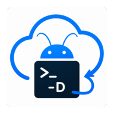

# SSHInjector

<div align="center">

**🌐 Языки:** [中文](README.md) · [English](README.en.md) · [Русский](README.ru.md)

</div>

<p align="center">
  
</p>

<div align="center">
  
  
  
  
  
</div>

<div align="center">
  <h3>🔐 SSH SOCKS5 прокси-приложение для Android 14+</h3>
  <p>VpnService захватывает трафик; встроенный SOCKS5-сервер пересылает его через SSH-туннели <code>direct-tcpip</code>; через прокси идут только выбранные приложения.</p>
</div>

---

## ✨ Возможности

| Функция | Описание |
|---------|----------|
| **Автонастройка сервера (мастер)** | Список серверов → **+** → «Автоматическая настройка»: создаёт аккаунт `sshproxy`, chroot, разворачивает ключ и усиливает sshd (OpenSSH / dropbear / OpenWrt) |
| **SSH-аутентификация** | ECDSA P-256 (мастер); импорт P-384 / RSA 4096 / Ed25519. Ключи в Android Keystore, биометрия, экспорт открытого ключа |
| **SOCKS5-прокси** | Прокси TCP CONNECT с IPv4/IPv6/доменами. **UDP-реле нет**: весь UDP, кроме DNS (53), отбрасывается и учитывается — см. ниже |
| **Режим белого списка** | `VpnService.addAllowedApplication()` — через прокси идут только выбранные приложения |
| **Двойной стек** | IPv4 + IPv6 с адресами обоих стеков на интерфейсе TUN |
| **Удалённый DNS** | Перехват UDP:53; в режимах REMOTE/WHITELIST возвращаются поддельные IP (`198.18.x.x` / `fd00::x`), домен разрешается на удалённой стороне по SSH; SYSTEM/разделение доменов — защищённые локальные сокеты |
| **Статистика доменов** | Домены за сессию (подключения/байты/приложение), локальное и удалённое разрешение IP, экспорт CSV, предложить→проверить→применить в списки (с отменой) |
| **Статистика соединения** | Статус соединения, трафик, время сессии (реальное время в процессе) |
| **Автопереподключение** | Автопереподключение при смене сети (WiFi↔5G, задержка 2с); линейная задержка на уровне SSH-сессии |
| **Проверка связи** | Сквозная проверка каждые 15 с + поэтапное здоровье (TUN/DNS/пересылка); ошибки по шагам: деградация/сбой · &lt;шаг&gt; |
| **Журнал приложения** | Копирование/экспорт журнала в `Download/`; снимки данных и сводка ошибок — диагностика без adb |
| **UI Material 3** | Панель, серверы, белый список, статистика доменов, журнал, настройки, ключи |

> **Про UDP**: это TCP-прокси SOCKS5, UDP ASSOCIATE не реализован. DNS (UDP:53) перехватывается приложением; остальной UDP (QUIC/игры), попадающий в TUN, отбрасывается и учитывается («UDP丢弃 N» в снимке). QUIC не переходит на TCP при ICMP-ошибках, поэтому такие приложения повторяют попытки сами и могут выглядеть «зависшими».

---

## 🏗 Архитектура

```
┌─────────────────────────────────────────────────────────────┐
│                      Android 14+                            │
├─────────────────────────────────────────────────────────────┤
│  UI Layer (Compose)                                         │
│  ├── DashboardScreen    ← статус/подключение/серверы         │
│  ├── ServerListScreen   ← серверы/мастер настройки           │
│  ├── WhitelistScreen    ← список приложений/выбор            │
│  ├── SettingsScreen     ← режим DNS/язык/биометрия           │
│  └── KeyManagerScreen   ← генерация ECDSA P-256/импорт/копия │
├─────────────────────────────────────────────────────────────┤
│  Domain Layer (UseCases)                                    │
│  ├── VpnController       ← жизненный цикл VPN/состояние      │
│  ├── ServerRepository    ← серверы/белые списки              │
│  └── KeyManager          ← генерация/импорт/подпись/экспорт  │
├─────────────────────────────────────────────────────────────┤
│  Data Layer                                                 │
│  ├── Room Database       ← Server/WhitelistApp               │
│  ├── DataStore           ← настройки/карта алиасов Keystore  │
│  ├── SshKeyManager       ← Android Keystore (не экспорт.)    │
│  ├── JschSshClient       ← SSH-подключение/туннель/keepalive │
│  ├── TunnelManager       ← мост локальный SOCKS5 ↔ SSH       │
│  ├── Socks5ProxyServer   ← SOCKS5 TCP (NIO Selector)         │
│  ├── PacketProcessor     ← разбор IP/TCP/UDP/пересылка       │
│  └── DnsInterceptor      ← перехват DNS/удалённое разрешение │
├─────────────────────────────────────────────────────────────┤
│  System Layer                                               │
│  ├── SshVpnService       ← VpnService (TUN/белый список)     │
│  └── BootReceiver        ← запуск при загрузке               │
└─────────────────────────────────────────────────────────────┘
```

> Упрощённая схема. Актуальный план данных (`SshIoDispatcher`, `TunWriter`, статистика доменов, поэтапное здоровье) — в `AGENTS.md` в корне репозитория.

---

## 🔧 Технологический стек

| Категория | Технология |
|-----------|------------|
| Язык/UI | Kotlin 2.4.20 + Jetpack Compose (Material 3) |
| Архитектура | MVVM + Clean Architecture + Repository |
| DI | Hilt 2.60.1 (KSP) |
| База данных | Room 2.8.4 (KSP) |
| Настройки | DataStore Preferences (Flow) |
| SSH-клиент | mwiede/jsch:2.28.7 (активный форк, поддержка Ed25519) |
| DNS | dnsjava 3.6.5 |
| Сеть I/O | Java NIO Selector + Kotlinx Coroutines |
| Keystore | Android Keystore + BiometricPrompt (ключи не экспортируются) |
| Coroutines | Kotlinx Coroutines 1.10.1 + Flow |
| Навигация | Navigation Compose 2.8.5 |

---

## 🚀 Быстрый старт

### Требования

- Android 14 (API 34) или новее
- Сервер: популярный Linux или **OpenWrt**, с OpenSSH или dropbear (для автоматической настройки нужны root или sudo)
- OpenSSH требует `AllowTcpForwarding yes` (по умолчанию; dropbear разрешает TCP-переадресацию по умолчанию)

### Настройка сервера: мастер (рекомендуется)

> **Где найти (часто ищут не там)**: **+** на главном экране открывает *ручное* добавление.
> Мастер: **Настройки → Управление серверами → + (вверху списка) → «Настройка сервера»**.

Мастер состоит из 4 шагов:

1. **Сервер**: имя, хост, порт SSH (по умолчанию 22)
2. **Логин**: пользователь с правами **root/sudo** и пароль — используются только для этой настройки, **не сохраняются**
3. **Настройка**: приложение генерирует пару ECDSA P-256 (защищена биометрией, если включено), затем проверяет права (root → sudo без пароля → sudo с паролем), загружает скрипт и проверяет его SHA-256 на сервере, загружает открытый ключ через stdin, выполняет скрипт и проверяет результат
4. **Готово**: сервер сохраняется автоматически, пользователь — `sshproxy`, ключ — сгенерированный мастером

На OpenSSH скрипт:

- Создаёт выделенный туннельный аккаунт `sshproxy`: `nologin` + заблокированный пароль, вход в shell невозможен
- Создаёт chroot с минимальной ФС (`ChrootDirectory`; родительский каталог принудительно принадлежит root)
- Только аутентификация по ключам (`PasswordAuthentication no`), `authorized_keys` заблокирован через `chattr +i`
- Добавляет блок `Match User sshproxy` в sshd; делает бэкап и перезагружает конфиг только после успешного `sshd -t`

**Вариант B: ручная настройка**

Следуйте **[docs/server-setup.md](docs/server-setup.md)** для ручного создания аккаунта `sshproxy`, каталога chroot и усиления sshd.

> **OpenWrt/dropbear**: dropbear работает в базовом режиме (аккаунт + только ключ, **без chroot / `chattr +i` / перезагрузки sshd**) и не меняет глобальный конфиг. Установите `openssh-server` для полного усиления. См. [docs/server-setup.md](docs/server-setup.md).

### Сборка

```bash
# Требуется JDK 17 (JDK 25 по умолчанию не собирает проект)
export JAVA_HOME=/path/to/jdk-17

# Клонирование
git clone https://github.com/tongtf/sshinjector.git
cd sshinjector

# Debug APK (разбивка по ABI; версия в имени файла — используйте glob)
./gradlew assembleDebug
#   app/build/outputs/apk/debug/sshinjector-<версия>-<abi>-debug.apk

# Release APK (общий keystore из keystore.properties в корне;
# при отсутствии — локальный debug key с предупреждением)
./gradlew assembleRelease
#   app/build/outputs/apk/release/sshinjector-<версия>-<abi>.apk
#   ABI: только arm64-v8a / armeabi-v7a

# Release AAB
./gradlew bundleRelease
#   app/build/outputs/bundle/release/sshinjector-<версия>-release.aab

# CI Release требует общий keystore и проверяет отпечаток подписанта APK.
```

---

## 📖 Использование

> Полное руководство: **[docs/USER_GUIDE.md](docs/USER_GUIDE.md)** (установка, настройка, устранение неполадок, FAQ); **[docs/README.md](docs/README.md)** — какие документы актуальные, а какие исторические
> Команды и откат сервера: **[docs/server-setup.md](docs/server-setup.md)**.
> Схемы: **[docs/diagrams/index.html](docs/diagrams/index.html)**.

### 1. Добавление сервера

- **Автоматически (рекомендуется)**: Настройки → Управление серверами → **+** → «Настройка сервера» (4 шага, см. выше).
- **Вручную**: **+** на главном экране или в списке серверов → «Добавить вручную». Ключ создаётся/импортируется отдельно, открытый ключ вставляется в `~/.ssh/authorized_keys`.
- Оба способа сохраняют сервер в одном списке; у серверов из мастера пользователь — `sshproxy`.

### 2. Настройка белого списка

1. Откройте **Настройки → Белый список**
2. Поиск/просмотр приложений; фильтры **Все / Выбранные / Системные**
3. Отметьте приложения для проксирования (вне режима белого списка через туннель идут все)

### 3. Подключение

1. Нажмите большую кнопку **Подключить**
2. Разрешите доступ к VPN при запросе
3. После успеха: локальный IP / выходной IP / статус (из сквозной проверки и поэтапного здоровья)
4. Постоянный статус в уведомлении; нажмите для отключения

### 4. Настройки

| Настройка | Описание |
|-----------|----------|
| Режим DNS | Удалённый (по умолчанию, защита от утечек) / прямой / белый список / разделение доменов; пустой белый список → локальный DNS (иначе поддельные IP без маршрута) |
| Список доменов | Домены для правил разделения |
| Статистика доменов | Домены/подключения/байты/приложение; предложения в списки (применение сразу) |
| MTU / keep-alive | Переопределяют настройки сервера; пусто = «как у сервера». Keep-alive 0 отключает heartbeat |
| Адрес проверки | Пусто = встроенный NCSI-эндпоинт; смените, если проверка стабильно падает после смены сервера |
| Язык | 中文 / English / Русский / системный |
| Биометрия | При включении разблокировка ключа требует отпечаток/лицо |

### 5. Статистика доменов и диагностика

- **Настройки → Статистика доменов**: домены за сессию с подключениями/байтами/приложением; экспорт CSV в `Download/`
- Фишки «Реклама / Прокси» только добавляют домен в **ожидающие предложения** — примените после проверки; есть отмена через Snackbar
- **Настройки → Журнал**: копирование/экспорт журнала (DEBUG скрыт по умолчанию). Без adb основной источник диагностики — снимок данных и сводка ошибок в конце журнала

---

## 🔒 Модель безопасности

```
Закрытый ключ → Android Keystore → изоляция на уровне системы
     ↓
Подпись ключа → BiometricPrompt (отпечаток/лицо) → согласие
     ↓
SSH-авторизация → JSch Identity → подпись Keystore
     ↓
Открытый ключ → формат OpenSSH → развёртывание на сервере
```

**Ключевые моменты:**
- Закрытый ключ **никогда не покидает** Keystore и не может быть экспортирован
- Пароли серверов и импортированные закрытые ключи хранятся в зашифрованном виде (**AES-256-GCM**, ключ в Android Keystore); шифротекст не покидает устройство. Импортированные ключи могут быть защищены паролем — пароль хранится зашифрованным вместе с ключом
- Ввод в форме сервера (имя хоста/IPv4/IPv6, порты, MTU, keep-alive) проверяется перед сохранением; недопустимые значения отклоняются
- TOFU при первом подключении (Trust On First Use) + кэш отпечатков ключей; при изменении отпечатка соединение отклоняется (защита от MITM)
- Разрешённые алгоритмы: KEX ECDH (nistp256/384/521) + DH group14/group-exchange (curve25519 остался только для JVM-тестов — на Android D8 не обрабатывает MR-JAR JSch), ключи хоста ed25519 / ECDSA / RSA-SHA2; `ssh-rsa` удалён
- Тип фонового сервиса `FOREGROUND_SERVICE_SPECIAL_USE`

---

## 📂 Структура проекта

```
SSHInjector/
├── app/
│   ├── src/main/
│   │   ├── java/cn/srv0/sshinjector/
│   │   │   ├── data/
│   │   │   │   ├── local/          # Room + DataStore
│   │   │   │   └── remote/         # ssh (JSch+Keystore) / tunnel / config (ServerProvisioner)
│   │   │   ├── domain/
│   │   │   │   ├── model/          # Доменные модели
│   │   │   │   ├── usecase/        # VpnController/Repository
│   │   │   │   └── vpn/            # VPN-компоненты (Socks5/TCP/UDP/DNS/туннель)
│   │   │   ├── di/                 # Hilt Modules
│   │   │   ├── ui/
│   │   │   │   ├── screen/         # Экраны (dashboard/server/whitelist/settings/keymanager)
│   │   │   │   ├── component/      # Общие компоненты
│   │   │   │   └── theme/          # Тема Material3
│   │   │   └── vpn/                # SshVpnService + BootReceiver
│   │   ├── res/                    # Ресурсы
│   │   └── AndroidManifest.xml
│   └── build.gradle.kts
├── docs/
│   ├── README.md                   # Указатель: актуальные документы и архив
│   ├── server-setup.md             # Настройка сервера и откат
│   ├── USER_GUIDE.md               # Руководство пользователя
│   ├── specs/                      # Проекты/аудиты/планы (в основном исторические)
│   └── diagrams/                   # Диаграммы архитектуры/потоков/состояний
├── .github/workflows/ci.yml        # CI/CD
├── detekt.yml                      # Правила стиля кода
├── cliff.toml                      # Генерация журнала изменений релиза
├── build.gradle.kts / settings.gradle.kts
└── README.md
```

---

## 🧪 Тестирование

```bash
# Модульные тесты
./gradlew testDebugUnitTest

# Проверки качества кода
./gradlew ktlintCheck detekt lint
```

---

## 📦 Чек-лист релиза

- [ ] Обновить версию (`versionCode` / `versionName`)
- [ ] Запустить полный конвейер CI (lint / detekt / ktlint / test)
- [ ] Отправить тег `v*` — CI собирает релиз и генерирует журнал изменений (git-cliff)
- [ ] Опубликовать APK/AAB в GitHub Releases / Play Console

---

## 🤝 Вклад

1. Сделайте форк репозитория
2. Создайте ветку: `git checkout -b feature/amazing-feature`
3. Внесите изменения: `git commit -m 'Add amazing feature'`
4. Отправьте: `git push origin feature/amazing-feature`
5. Откройте Pull Request

### Стиль кода

- Следуйте [соглашениям по коду Kotlin](https://kotlinlang.org/docs/coding-conventions.html)
- `ktlint` + `detekt` + `Android Lint` должны проходить
- Conventional Commits

---

## 📄 Лицензия

```
MIT License

Copyright (c) 2024 SSHInjector Contributors

Permission is hereby granted, free of charge, to any person obtaining a copy
of this software and associated documentation files (the "Software"), to deal
in the Software without restriction, including without limitation the rights
to use, copy, modify, merge, publish, distribute, sublicense, and/or sell
copies of the Software, and to permit persons to whom the Software is
furnished to do so, subject to the following conditions:

The above copyright notice and this permission notice shall be included in all
copies or substantial portions of the Software.

THE SOFTWARE IS PROVIDED "AS IS", WITHOUT WARRANTY OF ANY KIND, EXPRESS OR
IMPLIED, INCLUDING BUT NOT LIMITED TO THE WARRANTIES OF MERCHANTABILITY,
FITNESS FOR A PARTICULAR PURPOSE AND NONINFRINGEMENT. IN NO EVENT SHALL THE
AUTHORS OR COPYRIGHT HOLDERS BE LIABLE FOR ANY CLAIM, DAMAGES OR OTHER
LIABILITY, WHETHER IN AN ACTION OF CONTRACT, TORT OR OTHERWISE, ARISING FROM,
OUT OF OR IN CONNECTION WITH THE SOFTWARE OR THE USE OR OTHER DEALINGS IN THE
SOFTWARE.
```

---

## 🙏 Благодарности

- [mwiede/jsch](https://github.com/mwiede/jsch) — активно поддерживаемый форк JSch с поддержкой Ed25519
- [dnsjava](https://github.com/dnsjava/dnsjava) — библиотека DNS-протокола для Java
- [Android Networking Samples](https://github.com/android/networking-samples) — пример VpnService
- [SocksDroid](https://github.com/6b6b6b/socksdroid) — пример SOCKS5-прокси

---

## ⚠️ Отказ от ответственности

Этот проект предназначен только для обучения, исследований и защиты личной конфиденциальности. Пользователи несут ответственность за соблюдение местных законов и нормативных актов. Авторы не несут ответственности за любые последствия использования данного программного обеспечения.

---

<div align="center">
  <sub>Сделано с ❤️ для Android 14+ | <a href="https://github.com/tongtf/sshinjector">GitHub</a> | <a href="https://github.com/tongtf/sshinjector/issues">Issues</a></sub>
</div>
